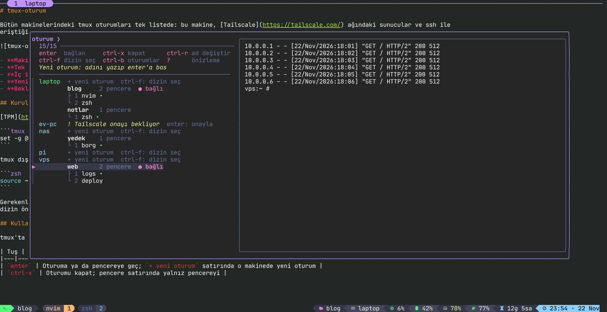

# tmux-oturum

Bütün makinelerindeki tmux oturumları tek listede: bu makine, [Tailscale](https://tailscale.com/) ağındaki sunucular ve ssh ile
eriştiğin öteki makineler. Birini seçip enter'a bas; oturum hangi makinede olursa olsun terminalin oraya geçer.



- **Makine listesi kendiliğinden:** Tailscale'de açık olan Linux makineler her açılışta bulunur, elle liste tutulmaz.
- **Tek bakışta:** her makinenin oturumları, pencereleri ve hangisine bağlı olduğun; seçili oturumun ekranı yanda.
- **İç içe tmux yok:** uzak oturuma geçince terminal doğrudan uzak tmux'a bağlanır; `prefix d` ile kaldığın yere dönersin.
- **Yeni oturum her yerde:** makinenin `+ yeni oturum` satırı, ya da `ctrl-f` ile o makinede bir dizin seçip orada.
- **Kayıtlı oturumlar:** [tmux-resurrect](https://github.com/tmux-plugins/tmux-resurrect) kaydında olup açık olmayan oturumlar
  bu makinenin altında `↺ kayıtlı` satırı; enter yalnız o oturumu kurar, bütün sunucuyu değil.
- **Beklemez:** makineler aynı anda sorulur, her birine en çok 2 sn; yanıt vermeyenler başlıkta sayılır, `ctrl-t` yeniden
  dener. `esc` hemen kapatır.

## Kurulum

[TPM](https://github.com/tmux-plugins/tpm) ile, `~/.tmux.conf` (ya da oh-my-tmux'ta `~/.tmux.conf.local`):

```tmux
set -g @plugin 'keyiflerolsun/tmux-oturum'
```

tmux dışında da açmak için `~/.zshrc` (zsh'ta `ctrl-g`):

```zsh
source ~/.tmux/plugins/tmux-oturum/oturum.zsh
```

Gerekenler: tmux ≥ 3.2 (oturum kapanınca öncekine dönüş için 3.4), fzf, bash. Tailscale makineleri için `tailscale` ve `jq`;
dizin önerileri için `zoxide`. Uzak makinede yalnız tmux.

## Kullanım

tmux'ta `prefix g`, zsh'ta `ctrl-g`. Listede olmayan bir ad yazıp enter'a basmak o adla yeni oturum açar. Makine adıyla
aramak o makinenin bütün satırlarını bırakır; bulanık arama için sorgunun başına `'`.

| Tuş | İş |
|---|---|
| `enter` | Oturuma ya da pencereye geç; `+ yeni oturum` satırında o makinede yeni oturum; `↺ kayıtlı` satırında oturumu kur ve geç |
| `ctrl-x` | Oturumu kaydedip kapat; pencere satırında yalnız pencereyi; `↺ kayıtlı` satırında kaydı unut |
| `ctrl-r` | Oturumun ya da pencerenin adını değiştir |
| `ctrl-f` | Satırın makinesinde dizin seç (ev dizini, zoxide geçmişi, `/opt`, `/srv`, …) ve orada yeni oturum aç |
| `ctrl-b` | Dizinlerden oturum listesine dön |
| `ctrl-t` | Listeyi yeniden yükle; yanıt vermeyen makineleri yeniden dener |
| `?` | Önizlemeyi aç, kapat |

Aynı adla oturum varsa yenisi açılmaz, ona geçilir. Bir oturumdaki son kabuğu kapatınca (`ctrl-d`) tmux'tan düşmezsin, önceki
oturuma geçersin. Kayıtlı oturum pencereleri, bölmeleri, dizinleri ve düzeniyle kurulur; çalışan programlar gelmez.

## Ayarlar

| Seçenek | Varsayılan | Ne yapar |
|---|---|---|
| `@oturum-tus` | `g` | prefix'ten sonra listeyi açan tuş |
| `@oturum-genislik` | `90%` | açılır pencerenin genişliği |
| `@oturum-yukseklik` | `75%` | açılır pencerenin yüksekliği |
| `@oturum-onizleme` | (boş) | önizlemenin yeri ve boyu, fzf yazımıyla; boşsa sağda %65 |
| `@oturum-makineler` | (boş) | Tailscale dışındaki makineler: `~/.ssh/config`'teki adları, boşlukla ayrılmış |
| `@oturum-onceye-don` | `on` | oturum kapanınca önceki oturuma geç |
| `@oturum-fzf` | (boş) | fzf'e eklenecek seçenekler (renk vb.) |
| `@oturum-sure` | `2` | makine başına bekleme üst sınırı (sn); aşan makine yanıt vermeyenlere düşer |

```tmux
set -g @oturum-tus 'f'                    # prefix f
set -g @oturum-onizleme 'down,50%'        # önizleme altta
set -g @oturum-makineler 'nas pi'         # ~/.ssh/config'teki Host adları
set -g @oturum-fzf "--color=bg+:#343746,pointer:#ff79c6"
```

## Bağlantı

- Tailscale makineleri: açık, Linux ve Tailscale SSH'ı olanlar `tailscale status`tan, `root` kullanıcısıyla. Host anahtarları da
  oradan gelir; ilk bağlantıda onay sorulmaz.
- `@oturum-makineler`: ssh config'teki kullanıcı, port ve anahtarla. Host anahtarını bir kez elle ssh ile kabul etmiş olmalısın,
  yoksa makine listede görünmez.
- Tailscale SSH'ın onay (check) istediği makine sarı satırda görünür. Enter onay adresini verir; tarayıcıda onaylayınca liste
  yeniden açılır.
- Her makineye en çok `@oturum-sure` (2 sn) beklenir; yanıt vermeyen makineler başlıkta adlarıyla görünür, `ctrl-t` yeniden
  dener. Bağlantı 10 dk açık tutulur, sonraki açılış ve önizlemeler hızlıdır. Makine yeniden başlayıp bağlantı bayatlarsa
  ~10 sn'de kapanır, sonraki açılış yenisini kurar.

## Geliştirme

- `test/sina.sh`: listeyi sahte makinelerle (`test/sahte/`) kurup sırasını ve biçimini denetler.
- `test/ekran.sh`: README ekran görüntüsünü (`.github/ekran.png`) kendi tmux görünümünle ve aynı sahte makinelerle yeniden çeker;
  gerçek makine adın ve oturumların görünmez. Gerekenler: `unshare`, `aha`, `chromium`.

## Kaynak

[omerxx/tmux-sessionx](https://github.com/omerxx/tmux-sessionx)'ten çatallanıp yeniden yazıldı. Lisans: GPL-3.0.
