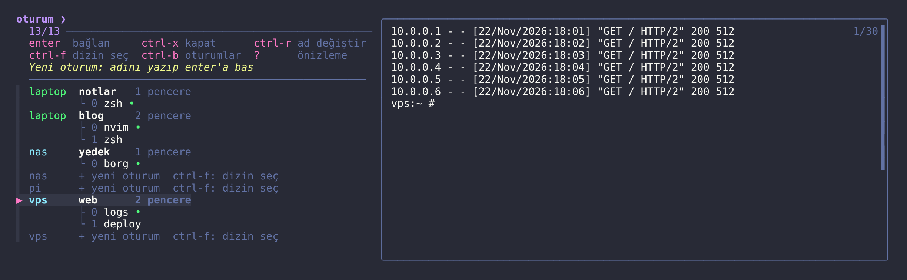

# tmux-oturum

Yerel makinenin ve [Tailscale](https://tailscale.com/) ağındaki makinelerin tmux oturumlarını ve pencerelerini tek listede açan tmux
eklentisi.



- **Çok cihaz:** Tailscale'de açık, Linux ve Tailscale SSH'ı olan makineler her açılışta `tailscale status`tan bulunur; hiçbir
  dosyaya makine adı yazılmaz. Tailscale dışındaki makineler `@oturum-makineler` ile eklenir. Makineler paralel sorulur, yanıt
  vermeyen 5 sn'de düşer.
- **Tablo:** makine, oturum, pencere sayısı ve bağlı mı sütunları hizalı; yerel makine yeşil, uzaklar camgöbeği. Her oturumun
  pencereleri altında ağaç gibi (`├ 1 zsh •`, etkin pencere yeşil nokta).
- **Önizleme:** oturumun ya da pencerenin ekranı, uzakta da. Varsayılan sağda %65; liste sütunu yine de 62 sütundan dar olmaz.
- **İç içe tmux yok:** uzak oturuma geçince terminal doğrudan uzak tmux'a bağlanır; orada `prefix d` ile kalınan yerel oturuma
  dönülür.
- **Yeni oturum:** listede olmayan bir ad yazıp enter; ya da `ctrl-f` ile satırın makinesinde bir dizin seçip orada (uzakta da).
  Oturumu olmayan makineler de `+ yeni oturum` satırıyla listede.
- **Kabuğa düşmeden:** bir oturum kapanınca (son kabukta Ctrl-D) önceki oturuma geçilir.

## Kurulum

`~/.tmux.conf` (ya da oh-my-tmux'ta `~/.tmux.conf.local`):

```tmux
set -g @plugin 'keyiflerolsun/tmux-oturum'
```

Gerekenler: tmux ≥ 3.2 (önceki oturuma dönüş için 3.4), fzf, bash. Çok cihaz için `tailscale` ve `jq`; dizin önerileri için
`zoxide` (yoksa yalnız klasörler listelenir). Uzak makinede yalnız tmux gerekir.

## Kullanım

`prefix g` açılır pencerede listeyi açar. tmux dışında aynı arayüz için kabukta:

```zsh
alias ts=~/.tmux/plugins/tmux-oturum/scripts/oturum
```

| Tuş | İş |
|---|---|
| `enter` | Oturuma ya da pencereye git; `+ yeni oturum` satırında o makinede ev dizininde yeni oturum |
| `ctrl-x` | Oturumu kapat; pencere satırında yalnız pencereyi (uzakta da) |
| `ctrl-r` | Oturumun ya da pencerenin adını değiştir |
| `ctrl-f` | Satırın makinesinde dizin seç: ev dizini (`~`), zoxide geçmişi, ev dizininin iki seviyesi, `/opt`, `/srv`, `/DATA` |
| `ctrl-b` | Dizinlerden oturum listesine dön |
| `?` | Önizlemeyi aç, kapat |

Aynı adla oturum varsa yenisi açılmaz, ona bağlanılır.

## Ayarlar

| Seçenek | Varsayılan | Ne yapar |
|---|---|---|
| `@oturum-tus` | `g` | prefix'ten sonra listeyi açan tuş |
| `@oturum-genislik` | `90%` | açılır pencerenin genişliği |
| `@oturum-yukseklik` | `75%` | açılır pencerenin yüksekliği |
| `@oturum-onizleme` | (boş) | önizlemenin yeri ve boyu, fzf yazımıyla. Boşsa sağda %65; liste yine de 62 sütundan dar olmaz |
| `@oturum-makineler` | (boş) | Tailscale dışındaki makineler: ssh config'teki adları, boşlukla ayrılmış |
| `@oturum-onceye-don` | `on` | oturum kapanınca önceki oturuma geç (`detach-on-destroy previous`) |
| `@oturum-fzf` | (boş) | fzf'e eklenecek seçenekler (renk vb.) |

Örnek (yalnız değiştirmek istediklerini yaz):

```tmux
set -g @oturum-tus 'f'                    # prefix f
set -g @oturum-genislik '80%'
set -g @oturum-yukseklik '85%'
set -g @oturum-onizleme 'down,50%'        # önizleme altta (üst–alt); 'right,60%' sağda %60
set -g @oturum-makineler 'nas pi'         # ~/.ssh/config'teki Host adları
set -g @oturum-onceye-don 'off'           # oturum kapanınca tmux'tan çık
set -g @oturum-fzf "--color=bg+:#343746,pointer:#ff79c6,header:#ff5555"
```

Tailscale'den gelen makineye `root` kullanıcısıyla (ssh anahtarı ya da Tailscale SSH), `@oturum-makineler`dekine ssh config'teki
kullanıcı, port ve anahtarla bağlanılır. Host anahtarı bir kez elle ssh ile kabul edilmemiş makine listeye girmez.

## Kaynak

[omerxx/tmux-sessionx](https://github.com/omerxx/tmux-sessionx)'ten çatallanıp yeniden yazıldı. Lisans: GPL-3.0.
